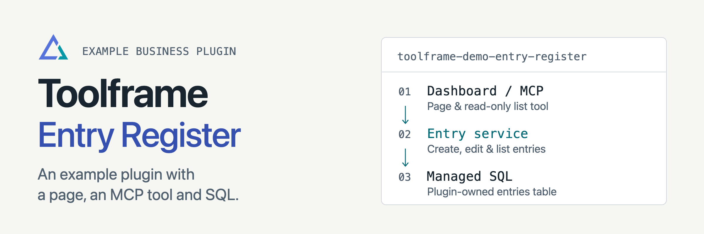

<p align="center">
<picture>
  <source media="(prefers-color-scheme: dark)" srcset="docs/assets/readme-banner-dark.png">
  <source media="(prefers-color-scheme: light)" srcset="docs/assets/readme-banner-light.png">
  
</picture>
</p>

# Toolframe Entry Register

[](https://github.com/toolframe/toolframe-demo-entry-register/actions/workflows/ci.yml?query=branch%3Amain)

Try a complete Toolframe app with editable entries, totals and a read-only MCP tool.
This example shows a business plugin owning its data, permissions, page and documentation.

## Quick start

With [uv](https://docs.astral.sh/uv/getting-started/installation/) installed:

```sh
uv tool install toolframe
toolframe --home ./my-app init --template entry-register
toolframe --home ./my-app serve
```

In another terminal, get the local sign-in link:

```sh
toolframe --home ./my-app open
```

The recipe installs SQLite, Dashboard, MCP, llms.txt and authentication providers.
It selects compatible stable versions and saves exact locks; keep `my-app` to
retain data. The native launcher supports macOS and glibc Linux on ARM64/x86-64.

**Access:** the demo starts with public Dashboard business access and MCP.
First-password creation protects Dashboard; MCP has a separate policy. The llms
document and explicitly published list HTTP method remain public. Review each
entrance before adapting the example for private records.

## Guides

| I want to… | Start here |
| --- | --- |
| Understand entries and permissions | [Usage](docs/usage.md) |
| Control provider versions | [Recipe contract](docs/recipe.md) |
| Follow the source | [Service](src/toolframe_demo_entry_register/service.py) · [Page](src/toolframe_demo_entry_register/page.py) |
| Add structured logs | [Logging](docs/logging.md) |
| Contribute or run checks | [Contributing](CONTRIBUTING.md) · [Verification](docs/ci.md) |

[Releases](https://github.com/toolframe/toolframe-demo-entry-register/releases)

## License

[MIT](LICENSE).
